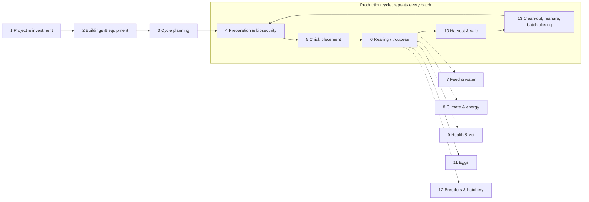

# Full functional scope: poultry farm management app (Morocco)

_Draft v0.1, 26 Oct 2026. It builds on [NEEDS-ANALYSIS.md](NEEDS-ANALYSIS.md) (legal, tax, ONSSA) and [BENCHMARK.md](BENCHMARK.md). Items marked ⚠️ must be validated with experts or farmers._

**Legend**
- ✅ = area you already named (**troupeau, finance, medical follow-up**)
- 🆕 = area that was missing
- ➕ = missing sub-process inside an area you named

---

## 1. The whole process at a glance

**Support processes that run all the time:**
- 14 Stock & purchasing
- 15 Finance
- 16 People
- 17 Compliance & documents
- 18 Risk & insurance
- 19 Market & seasonality
- 20 Partners
- 21 Traceability & quality
- 22 Knowledge & assistant
- 23 Analytics
- 24 Platform

---

## 2. Production types: one core, several variants

The app must handle these variants. Each one changes the cycle, the KPIs and the documents.

| Type | Cycle | Specific processes | Specific KPIs |
|---|---|---|---|
| **Broiler** (poulet de chair) | ~35–50 days | Brooding, thinning (partial early sale), fasting before catching | FCR, EPEF, avg daily gain, cost per kg |
| **Turkey** (dinde) | ~12–20 weeks, sexes raised apart | Longer brooding, beak care, two sale dates (hens / toms) | Same as broiler, per sex |
| **Pullet rearing** (poulette) | 0–17/18 weeks | Body weight and uniformity targets, lighting program, **transfer to laying house** | Uniformity %, weight vs standard |
| **Layer** (pondeuse) | ~18–80+ weeks | Egg collection, grading, packing, **cull-hen sale** (réforme) | Laying rate, eggs per hen housed, egg weight, feed per egg, % downgraded eggs |
| **Breeders** (reproducteurs) | Rearing + ~40 weeks of production | Male/female ratio, hatching-egg collection, **official health control** (law 49-99 art. 4) | Hatching eggs per hen, fertility |
| **Hatchery** (couvoir) | 21 days chicken / 28 duck & turkey | Egg storage, setting, candling, transfer, hatch, grading, chick vaccination, delivery | Hatch rate, hatch of fertile, chick quality |
| **Traditional / beldi / free-range** | Variable, mixed ages | Outdoor run, mixed flocks, sale per head | Survival, sale per head |
| **Other species** | Duck, goose, quail, guinea fowl, pigeon, ostrich (all covered by law 49-99) | Species-specific vaccines and cycles | Per species |
| **Downstream** _(later)_ | — | Egg packing centre, small approved slaughterhouse, direct sale | — |

---

## 3. Process catalogue

### 1. 🆕 Project & investment (before the first batch)
- **Feasibility simulator:** investment, cost per batch, break-even selling price, payback. The planning tools on TikVet and Aviculture au Maroc show demand for this.
- **Site check:** minimum distances to other farms and hatcheries (law 49-99 art. 3), water source, electricity, road access.
- **Authorization file** for farms above 500 birds per batch: checklist, documents, status, inspection date.
- **Financing file:** bank loan (Crédit Agricole), FDA subsidies, aggregation projects (law 04-12), schedule of works.
- **Business plan export** (PDF) for the bank.

### 2. 🆕 Buildings, equipment & maintenance
- **Farm → building (house) → zone register:** floor area, capacity, **density** (birds/m²), type (open / closed, controlled environment), GPS.
- **Equipment register:** feeders, drinkers, heaters (gas), fans, cooling pads, **generator**, silos, scales, controllers. Purchase date and value → **depreciation**.
- **Maintenance:** preventive schedule (generator test, fan belts, calibration of scales and sensors) and repair log with costs. Breakdowns are a real cause of mortality (heat, power cuts).
- **Spare parts** stock.

### 3. 🆕 Cycle planning
- **Placement calendar** across houses, all-in/all-out, including the **downtime between batches** (vide sanitaire).
- **Plan backwards from a target sale date.** Example: sell before Ramadan or the summer wedding season, and avoid selling right before or after Eid al-Adha, when demand drops by about 30% (Hespress).
- **Book chicks** with the hatchery: quantity, strain, date, price.
- **Forecast** feed needs, cash needs and labour per batch.

### 4. 🆕 Batch preparation & biosecurity
- **Clean-out checklist:** remove manure → wash → disinfect → downtime → litter → pre-heat (with dates and photos).
- **Disinfection log:** product, dose, date. Rodent control **with physical proof** (law 49-99 art. 15). Insect control.
- **Biosecurity:**
  - **visitor and vehicle register** (who came, from which farm, footbath, clothing);
  - zones (clean / dirty);
  - dead-bird disposal (art. 12).
- **Water quality:** lab analysis, chlorination, pipeline flushing.

### 5. 🆕 Chick placement
- **Delivery note** from the hatchery (goes into the ONSSA register): number, strain, hatchery origin, parent flock, price.
- **Chick quality at arrival:** day-old weight, uniformity, crop fill at 24 h, deaths at arrival, **claims to the hatchery**.
- Distribution of chicks per house and pen. Actual density.

### 6. ✅ Rearing / troupeau (➕ what was missing)
- Daily entry: mortality **+ cause**, culls, feed, water, eggs.
- ➕ **Weighings** (sample) → **uniformity (CV%)**, growth curve compared with the strain standard (Ross, Cobb, Hubbard, ISA, Lohmann, BUT…).
- ➕ **Lighting program**, **feed phases** (starter / grower / finisher) with transition dates.
- ➕ **Water/feed ratio**: an early warning of disease or heat stress.
- ➕ **Thinning** (partial early sale), transfers between houses (pullets → laying house).
- ➕ **Batch events log** (anything unusual) with photos and voice notes.
- KPIs: mortality %, FCR, EPEF, average daily gain, cost per kg, laying rate…

### 7. 🆕 Feed & water (largest cost item: 60–70% of production cost)
- Feed bought **ready-made** (by phase, supplier, price, delivery, **silo level**), OR
- ➕ **Feed made on the farm:** formulation (maize, soybean meal, premix, CMV), raw-material stock, mixing batches, cost per ton. Many medium farms mix their own feed. ⚠️ to validate.
- Feed quality issues and claims. **Comparison of feed suppliers** (FCR achieved per supplier).
- **Water consumption** per house per day (meter), cost of water.

### 8. 🆕 Climate & energy
- Temperature, humidity, ammonia/CO₂ readings: entered by hand, from sensors, or from controllers (Rotem / Munters / Fancom).
- **Heat-stress management:** weather forecast alerts (heatwave, chergui), action plan (cooling pads, lower density, change feeding times). Summer heatwaves cause big mortality spikes in Morocco (Hespress 2023).
- **Energy:** gas bottles or propane for brooding (a major cost), electricity, **diesel for the generator**. Cost per batch.
- **Power-cut log** and alarm escalation (WhatsApp / phone call).

### 9. ✅ Health & vet (➕ what was missing)
- Vaccination program, treatments, withdrawal periods, **ONSSA health register** (see NEEDS-ANALYSIS §4).
- ➕ **Designated vet** account: visits, **post-mortems** (findings), prescriptions, e-signature.
- ➕ **Lab analyses:** serology (to check vaccine protection), salmonella, water. Results attached to the batch.
- ➕ **Vaccination method** (drinking water, spray, eye drop, injection), vaccine lot and expiry, cold chain.
- ➕ **Notifiable diseases** (avian influenza, Newcastle, Pullorum): suspicion → declaration → quarantine workflow, with evidence kept for **state compensation** (only for certified farms, law 49-99 art. 8) and **MAMDA insurance** (an IAHP/Newcastle/Pullorum product since 2019).
- ➕ **Antibiotic usage tracking** (mg per kg produced), which is relevant for residue controls (art. 9, 11) and for future label or export requirements.
- ➕ **Farm pharmacy** stock (lot, expiry, storage temperature).

### 10. 🆕 Harvest, sale & market
- **Decide when to sell:** projected weight × current price − feed cost of extra days → the best selling date.
- **Pre-catch:** feed withdrawal (fasting) timing, catching crew booking, crates, transport (disinfected, law 49-99 art. 14).
- **Weighing:** truck scale or sample weighing. **Weight shrink / weighing gap** between farm and buyer.
- **Buyers:** traders (chevillards), live-bird markets (riyachates), industrial abattoirs, retailers. Price per kg, **payment terms, cheques / bills of exchange, receivables**.
- **Origin document** for industrial abattoirs (art. 10). **Condemnations / rejects** reported back by the abattoir.
- **Market price index** (regional, daily) + buyer marketplace (see BENCHMARK, gap #1).

### 11. 🆕 Eggs (layers)
- Collection several times a day. Counts: normal / cracked / dirty / double-yolk / floor eggs.
- **Grading** by weight class, packing (trays of 30, cases), storage temperature, **stock of eggs** and their age.
- Egg sales (B2B, wholesale, direct). **Cull-hen sale** at the end of the cycle.
- Egg marking and labelling rules (law 49-99 art. 3-2°, 16). ⚠️ to detail.

### 12. 🆕 Breeders & hatchery
- Breeders: male/female ratio, male replacement (spiking), hatching-egg collection, egg disinfection.
- Hatchery: egg reception per breeder flock, storage days, **incubator setting**, candling (infertile / early death), transfer to hatcher, hatch, chick grading and sexing, vaccination, **chick sale and delivery** (generates the delivery note for the buyer farm's register), hatchery waste.
- **Incubator monitoring** (temperature, humidity, turning): what poultry.ma does with ESP32.

### 13. 🆕 Clean-out, by-products & batch closing
- **Manure / litter removal:** quantity, **sale as fertilizer**. This is a revenue line that is often forgotten. Storage and spreading rules (art. 13).
- **Dead-bird disposal** log (incinerator / authorized site).
- **Batch closing report:** all KPIs, P&L, comparison with previous batches and with the strain standard, lessons learnt.

### 14. Stock & purchasing (partly covered)
- Items: feed, raw materials, chicks, medicines and vaccines, disinfectants, litter, gas, diesel, spare parts, packaging.
- Purchase requests → orders → reception → supplier invoice → payment. **Supplier credit** (feed is often advanced). ⚠️ to validate.
- Multi-site stock, transfers, inventory counts, lot and expiry tracking.

### 15. ✅ Finance (➕ what was missing)
- Accounting profile per legal form (individual, indivision, company / PCGE, cooperative chart of accounts, association): see NEEDS-ANALYSIS §3.
- ➕ **Cash & bank:** cash book, bank accounts, **cheques and bills of exchange (traites)** received and issued, with due dates. These are very common in Moroccan B2B trade.
- ➕ **Receivables and payables** with ageing. **Credit limit per buyer.**
- ➕ **Budget & forecast** per batch and per year. **Break-even price** per kg. "What-if" on feed price or selling price.
- ➕ **Loans** (schedule, interest), **subsidies** (status), **depreciation** of buildings and equipment.
- ➕ **Worker advances** (avances sur salaire), owner withdrawals.
- ➕ **Cost allocation** of shared costs (electricity, salaries, vet contract) across batches and houses.
- ➕ Tax helpers: 5M DH threshold tracker, VAT if applicable, export to the accountant.

### 16. 🆕 People (workforce)
- Workers (often **living on the farm**), roles, shifts, **daily task lists** per house (generated from the batch age: "day 14: Gumboro vaccine").
- Attendance, pay (SMAG), advances, **CNSS / AMO** declaration export.
- Training records (biosecurity, vaccination technique). Work accidents.
- **Permissions:** a worker enters data but cannot see finance.

### 17. 🆕 Compliance & document vault
- Authorizations, ONSSA register, vet contract, lab reports, insurance policies, land / lease documents, company or cooperative documents, tax filings.
- **Alerts before expiry dates** (authorization renewal, insurance, generator inspection…).
- One-click **inspection pack** (everything an ONSSA inspector asks for).

### 18. 🆕 Risk & insurance
- Insurance policies (MAMDA or other), claims with evidence (mortality records, vet report, photos).
- Risk alerts: heatwave, disease outbreaks in the region (from public ONSSA notices), price crash, feed shortage.
- **Business continuity:** what to do if there is a power cut, outbreak or feed shortage.

### 19. 🆕 Market & seasonality
- Prices: chicks, feed, live broilers, eggs, cull hens. Regional, with history.
- **Seasonal calendar:**
  - **Ramadan:** demand rises, mainly in the second half.
  - **Eid al-Adha:** demand drops about 30% before Eid and prices stay low for weeks after it.
  - **Summer:** heat mortality, plus weddings.
  - Feed price is linked to imported maize and soybean.
- Over-supply signals: chick placements per week, published by FISA.

### 20. 🆕 Partners & ecosystem (multi-actor)
| Actor | What they do in the app |
|---|---|
| Vet | Visits, prescriptions, register sign-off, alerts on their client farms |
| Accountant | Read access + exports per accounting profile |
| Integrator / aggregator | Contracted farms dashboard, inputs advanced, settlement |
| Cooperative | Members, shares, pooled purchases and sales, general assembly |
| Buyers / traders | Receive "batch ready" offers, confirm weight and price |
| Suppliers (feed, chicks, vet products) | Orders, deliveries, invoices |
| Bank / insurer | Read-only reports, with the farmer's consent |

### 21. 🆕 Traceability & quality
- Batch ID that follows the chain: hatchery → farm → buyer or abattoir. **QR code** per batch or per egg tray.
- Quality schemes and labels (organic, free-range, "beldi"). Law 49-99 art. 16 forbids such claims without a specification document (cahier des charges).
- Customer complaints and recalls.

### 22. 🆕 Knowledge & assistant
- Guides per species and per age (in Arabic / French), disease library with photos.
- **AI assistant** (Arabic / French; voice and Darija later): "Is mortality of 0.4% at day 5 normal?", "Which vaccine is due?". Clearly marked as **not a diagnosis**, and it refers the farmer to the vet.

### 23. Analytics & reporting
- Dashboards per farm, house and batch. Comparison of batches, houses and suppliers.
- **Anonymous benchmark against similar farms** (region, strain, season), possible once there are enough users.
- Standard reports: batch closing, ONSSA register, P&L, bank pack, cooperative general assembly pack, tax export.

### 24. Platform (cross-cutting)
- Organisations → legal entities → farms → houses → batches. **Several farms per owner, several owners per farm** (indivision, cooperative).
- Roles & permissions, audit log (who changed what).
- **Offline-first** mobile, **Arabic (RTL) / French**, WhatsApp notifications and data entry ⚠️. _Darija and voice entry are deferred, not in the first versions._
- Integrations: sensors and controllers, scales, weather API, WhatsApp, payments (CMI, mobile wallets), exports (Excel / PDF / accounting).
- Data ownership and export at any time, **law 09-08 / CNDP** (Moroccan data protection), backups.
- Billing of our own SaaS: per farm, per house, per batch, or paid by the integrator. ⚠️ to decide.

---

## 4. Summary: what was missing from "troupeau + finance + medical"

| Missing area | Why it matters |
|---|---|
| Project & investment | Every new farmer starts here, and the bank needs the file |
| Buildings, equipment & maintenance | Breakdowns kill birds. Depreciation is needed for accounting |
| Cycle planning & seasonality | Timing the sale is worth more than any other optimization (Eid / Ramadan / summer) |
| Preparation & biosecurity | Prevents disease. Required by law 49-99 |
| Chick placement quality | Bad chicks = a bad batch. Claims to the hatchery |
| Feed (incl. own mixing) & water | 60–70% of costs |
| Climate & energy | Heat stress, gas and generator costs |
| Harvest & sale | Where the money is made or lost. Weighing gaps, cheques, receivables |
| Eggs / hatchery variants | Separate business processes |
| Manure & by-products | Forgotten revenue. Legal obligation |
| People | Workers enter the data. Pay and CNSS |
| Documents, risk & insurance | Inspections, claims, compensation |
| Partners (vet, accountant, buyers, integrator, coop) | The app becomes a network, not just a notebook |
| Traceability & labels | Abattoir requirements, future exports, quality premium |

---

## 5. Suggested build order (to discuss later, after interviews)

| Phase | Content |
|---|---|
| **MVP** | Areas 2 (light) · 5 · 6 · 7 (bought feed) · 9 (vaccines, treatments, ONSSA register) · 10 (sales + receivables) · 13 (closing) · 14 (basic stock) · 15 (cash book + margin per batch) · 24 (offline, AR/FR, roles). **Broiler first.** |
| **V2** | 3 Planning · 4 Biosecurity · 8 Climate (manual + alerts) · 16 People · 17 Documents · 19 Prices · 20 Vet + accountant access · layers (11) |
| **V3** | Hatchery (12) · own feed mixing · cooperative and integrator modules · IoT / controllers · marketplace · AI assistant · benchmark across farms · full accounting |

## 6. Open questions for the interviews

1. Do medium broiler farms **mix their own feed**, or buy ready-made feed? What share does each?
2. How are buyers paid: cash, cheque, bill of exchange? What are the typical delays?
3. Who enters the data on the farm, and on what phone?
4. Do farms sell their manure? At what price?
5. How often do vets actually visit? Who pays?
6. Which documents do ONSSA inspectors actually ask for?
7. Integrators: what do they need to see from their contracted farms?

## Sources (in addition to NEEDS-ANALYSIS.md)
- MAMDA × FISA poultry insurance: https://medias24.com/2019/04/18/la-mamda-lance-un-nouveau-produit-dassurance-volaille/ · https://fnh.ma/article/laquotidienne/mamda-fisa-une-convention-pour-la-promotion-de-l-assurance-dans-le-secteur-avicole
- Eid al-Adha drop in demand: https://fr.hespress.com/319847-baisse-des-prix-du-poulet-avant-laid-al-adha-au-maroc-la-consommation-en-baisse-de-30.html · https://telquel.ma/instant-t/2023/07/14/les-prix-du-poulet-chutent-drastiquement-apres-aid-al-adha_1821658/
- Ramadan demand: https://h24info.ma/?p=984366
- Heatwave mortality: https://fr.hespress.com/327432-vague-de-chaleur-impact-sur-la-production-avicole-et-sur-les-prix.html
- Feed share of cost: https://kolonell.com/fr/blog/logiciel-aviculture-poulailler-suivi-2026
